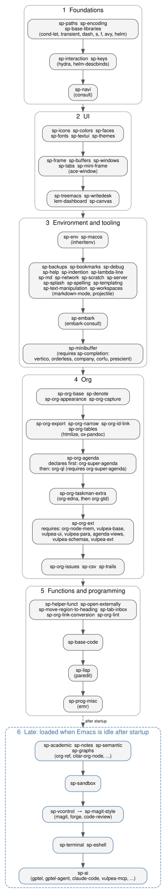
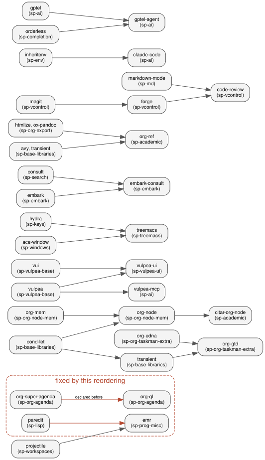

#+title: Module load order: what loads when, and why
#+startup: overview

The modules listed in =lem--default-modules= (in =init.el=) are loaded top to bottom, and Elpaca installs the packages of each module as the =use-package= forms are read. The order matters for two reasons, and this page records both, so that a new module can be put in the right place.

1. *A package must be declared before the packages that require it.* Elpaca queues the dependencies of every package it sees. If =org-ql= is declared first, Elpaca queues =org-super-agenda= (which =org-ql= requires) as its dependency, and when the explicit =(use-package org-super-agenda ...)= follows, it warns =org-super-agenda previously queued as dependency of: (org-ql)=. The warning is only logged during init (Elpaca checks =after-init-time=), but Elpaca does not queue the explicit declaration again, so its recipe options (such as =:ensure (:wait t)= or a git source) are not applied.
2. *Anything that stops init costs startup time.* A recipe with =:ensure (:wait t)= makes Elpaca finish its queue up to that point before init goes on, so each one is a barrier. Modules that nothing else needs are loaded after startup instead (see [[*Late modules][Late modules]]).

* The order

#+begin_src dot :file load-order-modules.svg :exports both :results file
digraph modules {
  rankdir=TB; compound=true; nodesep=0.25; ranksep=0.45;
  node [shape=box, style="rounded,filled", fillcolor="#f4f4f4", color="#555555", fontname="Helvetica", fontsize=11];
  edge [color="#555555", fontname="Helvetica", fontsize=9];

  subgraph cluster_1 { label="1  Foundations"; style=rounded; color="#999999"; fontname="Helvetica";
    p1 [label="sp-paths  sp-encoding\nsp-base-libraries\n(cond-let, transient, dash, s, f, avy, helm)"];
    p2 [label="sp-interaction  sp-keys\n(hydra, helm-descbinds)"];
    p3 [label="sp-navi\n(consult)"];
    p1 -> p2 -> p3;
  }
  subgraph cluster_2 { label="2  UI"; style=rounded; color="#999999"; fontname="Helvetica";
    u1 [label="sp-icons  sp-colors  sp-faces\nsp-fonts  sp-emoji-font\nsp-textui  sp-themes"];
    u2 [label="sp-frame  sp-buffers  sp-windows\nsp-tabs  sp-mini-frame\n(ace-window)"];
    u3 [label="sp-treemacs  sp-writedesk\nlem-dashboard  sp-canvas"];
    u1 -> u2 -> u3;
  }
  subgraph cluster_3 { label="3  Environment and tooling"; style=rounded; color="#999999"; fontname="Helvetica";
    e1 [label="sp-env  sp-macos\n(inheritenv)"];
    e2 [label="sp-backups  sp-bookmarks  sp-debug\nsp-help  sp-indention  sp-lambda-line\nsp-md  sp-network  sp-scratch  sp-server\nsp-splash  sp-spelling  sp-templating\nsp-text-manipulation  sp-workspaces\n(markdown-mode, projectile)"];
    e3 [label="sp-embark\n(embark-consult)"];
    e4 [label="sp-minibuffer\n(requires sp-completion:\nvertico, orderless, company, corfu, prescient)"];
    e1 -> e2 -> e3 -> e4;
  }
  subgraph cluster_4 { label="4  Org"; style=rounded; color="#999999"; fontname="Helvetica";
    o1 [label="sp-org-base  sp-org-keywords\nsp-denote  sp-org-appearance"];
    o2 [label="sp-org-export  sp-org-narrow  sp-org-id-link\nsp-org-tables\n(htmlize, ox-pandoc)"];
    o3 [label="sp-org-agenda\n(org-other-agenda, elegant-agenda-mode)\ndeclares first: org-super-agenda (:wait t)\nthen: org-ql (requires org-super-agenda)"];
    o4 [label="sp-org-taskman-extra\n(org-edna, then org-gtd)"];
    o5 [label="sp-org-ext\nrequires: org-node-mem, vulpea-base,\nvulpea-ui, vulpea-para,\nvulpea-schemas, vulpea-ext"];
    o6 [label="sp-csv  sp-org-normalise\nsp-org-issues"];
    o7 [label="sp-org-capture  sp-agenda-views\n(last: each assigns its variable once)"];
    o1 -> o2 -> o3 -> o4 -> o5 -> o6 -> o7;
  }
  subgraph cluster_5 { label="5  Functions and programming"; style=rounded; color="#999999"; fontname="Helvetica";
    f1 [label="sp-helper-funct  sp-open-externally\nsp-move-region-to-heading  sp-tab-inbox\nsp-org-link-conversion  sp-org-lint"];
    g1 [label="sp-base-code"];
    g2 [label="sp-lisp\n(paredit)"];
    g3 [label="sp-prog-misc\n(emr)"];
    f1 -> g1 -> g2 -> g3;
  }
  subgraph cluster_6 { label="6  Late: loaded when Emacs is idle after startup"; style="rounded,dashed"; color="#3a6ea5"; fontcolor="#3a6ea5"; fontname="Helvetica";
    l1 [label="sp-academic  sp-notes  sp-trails\nsp-semantic  sp-graphs  sp-embr\n(org-ref, citar-org-node, ...)", color="#3a6ea5"];
    l2 [label="sp-sandbox", color="#3a6ea5"];
    l3 [label="sp-vcontrol  →  sp-magit-style\n→  sp-merge-pick\n(magit, forge, code-review)", color="#3a6ea5"];
    l4 [label="sp-terminal  sp-eshell", color="#3a6ea5"];
    l5 [label="sp-ai\n(gptel, gptel-agent, claude-code, vulpea-mcp, ...)", color="#3a6ea5"];
    l6 [label="sp-tag-emoji  sp-thesis-dump", color="#3a6ea5"];
    l1 -> l2 -> l3 -> l4 -> l5 -> l6;
  }
  p3 -> u1 [ltail=cluster_1, lhead=cluster_2];
  u3 -> e1 [ltail=cluster_2, lhead=cluster_3];
  e4 -> o1 [ltail=cluster_3, lhead=cluster_4];
  o7 -> f1 [ltail=cluster_4, lhead=cluster_5];
  g3 -> l1 [ltail=cluster_5, lhead=cluster_6, style=dashed, label="after startup"];
}
#+end_src

#+RESULTS:

(The Org box above changed with [[file:../../../adr/0009-one-agenda-owner-per-setting.org][ADR 0009]]: =sp-org-keywords= comes after =sp-org-base=, and =sp-org-capture= and =sp-agenda-views= load last in the box.)

Inside a box the modules are independent of each other. An arrow means "has to come before" (it points from the package that is required to the one that requires it, the opposite of a dependency arrow). The parenthesised names are the packages whose position matters.

* Why each arrow is there

Each row is an order the graph enforces: the package on the left must be declared (and, for =:wait t=, installed) before the one on the right. The /source/ column says where the requirement was read from.

#+begin_src dot :file load-order-packages.svg :exports both :results file
digraph packages {
  rankdir=LR; nodesep=0.15; ranksep=0.5;
  node [shape=box, style="rounded,filled", fillcolor="#f4f4f4", color="#555555", fontname="Helvetica", fontsize=10];
  edge [color="#555555", fontname="Helvetica", fontsize=8];
  subgraph cluster_fixed { label="fixed by this reordering"; style="rounded,dashed"; color="#b5472f"; fontcolor="#b5472f"; fontname="Helvetica";
    "org-super-agenda\n(sp-org-agenda)" -> "org-ql\n(sp-org-agenda)" [color="#b5472f", label="declared before"];
    "paredit\n(sp-lisp)" -> "emr\n(sp-prog-misc)" [color="#b5472f"];
  }
  "cond-let\n(sp-base-libraries)" -> "transient\n(sp-base-libraries)" -> "org-gtd\n(sp-org-taskman-extra)";
  "cond-let\n(sp-base-libraries)" -> "org-node\n(sp-org-node-mem)";
  "org-edna\n(sp-org-taskman-extra)" -> "org-gtd\n(sp-org-taskman-extra)";
  "org-mem\n(sp-org-node-mem)" -> "org-node\n(sp-org-node-mem)" -> "citar-org-node\n(sp-academic)";
  "vui\n(sp-vulpea-base)" -> "vulpea-ui\n(sp-vulpea-ui)";
  "vulpea\n(sp-vulpea-base)" -> "vulpea-ui\n(sp-vulpea-ui)";
  "vulpea\n(sp-vulpea-base)" -> "vulpea-mcp\n(sp-ai)";
  "hydra\n(sp-keys)" -> "treemacs\n(sp-treemacs)";
  "ace-window\n(sp-windows)" -> "treemacs\n(sp-treemacs)";
  "consult\n(sp-search)" -> "embark-consult\n(sp-embark)";
  "embark\n(sp-embark)" -> "embark-consult\n(sp-embark)";
  "htmlize, ox-pandoc\n(sp-org-export)" -> "org-ref\n(sp-academic)";
  "avy, transient\n(sp-base-libraries)" -> "org-ref\n(sp-academic)";
  "projectile\n(sp-workspaces)" -> "emr\n(sp-prog-misc)";
  "markdown-mode\n(sp-md)" -> "code-review\n(sp-vcontrol)";
  "magit\n(sp-vcontrol)" -> "forge\n(sp-vcontrol)" -> "code-review\n(sp-vcontrol)";
  "inheritenv\n(sp-env)" -> "claude-code\n(sp-ai)";
  "gptel\n(sp-ai)" -> "gptel-agent\n(sp-ai)";
  "orderless\n(sp-completion)" -> "gptel-agent\n(sp-ai)";
}
#+end_src

#+RESULTS:

| Required package (module)           | Needed by (module)                 | Source of the requirement                                      |
|-------------------------------------+------------------------------------+----------------------------------------------------------------|
| =org-super-agenda= (sp-org-agenda)  | =org-ql= (was sp-org-base)         | =org-ql.el= =Package-Requires=; *this was the reported warning* |
| =paredit= (sp-lisp)                 | =emr= (sp-prog-misc)               | =emr.el= =Package-Requires=; *loaded after it before, fixed*   |
| =cond-let= (sp-base-libraries)      | =transient=, =org-node=, =hl-todo= | =Package-Requires= of each                                     |
| =org-edna= (sp-org-taskman-extra)   | =org-gtd=                          | =org-gtd.el= =Package-Requires=                                |
| =org-mem= (sp-org-node-mem)         | =org-node=                         | declared first in the module                                   |
| =org-node= (sp-org-node-mem)        | =citar-org-node= (sp-academic)     | the package's name and purpose (not read from its header)      |
| =vui=, =vulpea= (sp-vulpea-base)    | =vulpea-ui=                        | =vulpea-ui.el= =Package-Requires=                              |
| =ace-window=, =hydra=               | =treemacs=                         | =treemacs.el= =Package-Requires=                               |
| =consult=, =embark=                 | =embark-consult=                   | =embark-consult.el= =Package-Requires=                         |
| =htmlize=, =ox-pandoc=, =avy=, =transient= | =org-ref=                   | =org-ref.el= =Package-Requires=                                |
| =projectile= (sp-workspaces)        | =emr=                              | =emr.el= =Package-Requires=                                    |
| =markdown-mode= (sp-md)             | =code-review=                      | =code-review.el= =Package-Requires=                            |
| =magit= → =forge= (sp-vcontrol)     | =code-review=                      | =code-review.el= =Package-Requires=                            |
| =inheritenv= (sp-env)               | =claude-code=                      | =claude-code.el= =Package-Requires=                            |
| =gptel=, =orderless=                | =gptel-agent=                      | =gptel-agent.el= =Package-Requires=                            |

The =Package-Requires= headers were read from each package's upstream repository on GitHub. They list names, not recipes, so which Elpaca recipe a name resolves to is not shown here.

* What changed in the order

** =org-ql= moves from =sp-org-base= to =sp-org-agenda=
=org-ql= was installed in =sp-org-base=, the first Org module, and =org-super-agenda= in =sp-org-agenda=, a few modules later. =org-ql= requires =org-super-agenda=, so Elpaca queued it as a dependency and then warned when =sp-org-agenda= declared it explicitly. The =org-ql= form now sits right after the =org-super-agenda= form. Nothing between the two modules uses =org-ql= (=sp-trails= requires it, and loads later).

** =sp-lisp= loads before =sp-prog-misc=
=emr= in =sp-prog-misc= requires =paredit=, which =sp-lisp= installs. The two modules swap places. =sp-lisp= does not use anything from =sp-prog-misc=.

** Late modules
=sp-academic=, =sp-notes=, =sp-trails=, =sp-semantic=, =sp-graphs= (which holds the four graph modules that were listed one by one before), =sp-embr=, =sp-sandbox=, =sp-vcontrol=, =sp-magit-style=, =sp-merge-pick=, =sp-terminal=, =sp-eshell=, =sp-ai=, =sp-tag-emoji= and =sp-thesis-dump= no longer load while Emacs starts. They are listed in =lem--late-modules= (in dependency order: =sp-vcontrol= before =sp-magit-style= and =sp-merge-pick=; =sp-embr= after =sp-graphs=, whose live view it shows), and loaded 0.5 seconds after Emacs first goes idle once Elpaca has finished its initial queues, through =elpaca-after-init-hook=. They were picked because:

- no other module =require=s them, so nothing is left waiting for them;
- they install the most and the heaviest packages (the AI tools, =org-ref= with its dependencies, =magit= with =forge= and =code-review=);
- the keys that matter before they load are still there: =sp-keys= autoloads the =magit= commands it binds.

The cost is that their own keys and commands (for example =C-M-g= for =magit=, bound in =sp-vcontrol=) only work from the moment they have loaded, a second or so after startup. To load them with everything else, in the same order as the list, set =sp-defer-late-modules= to =nil=.

** What stays as it was
The order inside the UI, tooling and Org groups is unchanged, because I found no requirement between their packages that the current order breaks. Duplicate explicit declarations of one package (=hl-todo= in =sp-faces= and =sp-org-taskman-extra=, =org-autolist= in =sp-org-appearance= and =sp-org-ext=, =elisp-demos= in =sp-help= and =sp-lisp=, =company= in =sp-completion= and =sp-base-code=) are not an ordering problem and have been left alone. The minimal list (=-minimal=) is as before.

* How to place a new module

1. Find what its packages require (the =Package-Requires= header of each).
2. If a required package is installed by another module, put the new module after it. If it is a package you install in the same module, declare it first.
3. If the rest of init needs the package at load time, give it =:ensure (:wait t)= and keep it near the top. If it is only used interactively, add the module to =lem--late-modules= instead.
4. Add it to the graph above and to the module tree in [[file:../main.org][main.org]].

* What has been checked

- =init.el= and the changed modules were read back by Emacs 29.3 (all forms read); the late-module functions were run against stubs, which loaded the twelve modules in order and asked Elpaca to process its queues.
- The dependency edges come from =Package-Requires= headers on GitHub (see above), not from a run of Elpaca: MELPA is not reachable from where this was prepared, so a real startup with the new order, and with =sp-defer-late-modules= on, has not been done.
- Whether Elpaca installs and configures packages declared after init without further help (the reason =lem--load-late-modules= calls =elpaca-process-queues=) follows from reading =elpaca.el=, and is untested.
