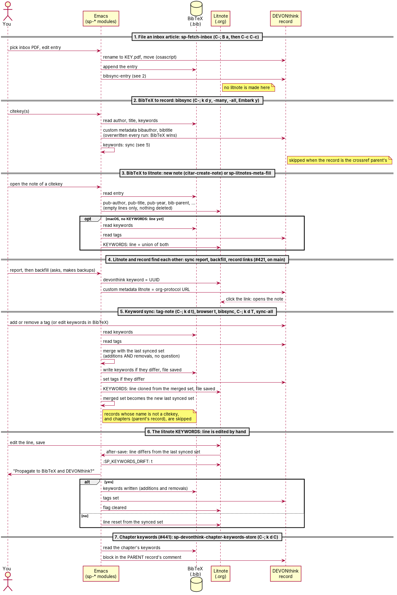

#+TITLE: sp-devonthink.el: DEVONthink records from Org and litnotes
#+PROPERTY: header-args:emacs-lisp :tangle ../../../libraries/modules/academic/sp-devonthink.el :comments no :padline yes :noweb no :mkdirp yes
#+STARTUP: content

Literate source for =libraries/modules/academic/sp-devonthink.el=. It also holds the design of the whole DEVONthink and Emacs integration (section "Design"); the sibling modules link here.

- Start with "Current state" below: it covers the whole DEVONthink integration (all modules, keys, options, limitations).
- The "Design" section is the plan the integration was built from; where it differs from "Current state", "Current state" is right (for example, search is now part of =sp-devonthink-browse=, #500).

- Every line of the module lives in the =emacs-lisp= blocks below, in order.
- The =:tangle= path in the =#+PROPERTY= line at the top says where they are written.
- To tangle, see [[file:../../tangling-instructions.org][Tangling instructions]].
- Status: macOS only. The pure parts are covered by =tests/sp-devonthink-test.el=; the AppleScript was not run when this was written (see "Current state" and the end of this file).

* Design

- This section replaces the old design document =docs/architecture/devonthink-emacs-integration.org= (proposed in #209, 2026-10-31).
  - Last version of the old document: [[https://github.com/siainbuletin/dotfiles/blob/c0188a9f0b7c1840034707d3866582a5000eeea3/emacs-modular/.config/emacs-modular/docs/architecture/devonthink-emacs-integration.org][devonthink-emacs-integration.org]] at its last commit, [[https://github.com/siainbuletin/dotfiles/commit/c0188a9f0b7c1840034707d3866582a5000eeea3][=c0188a9f=]] (2026-11-08, "Make devonthink-reading.py literate").
  - It was removed when this section took over its content (commit =b22a07d9=, PR #419); =git show c0188a9f:emacs-modular/.config/emacs-modular/docs/architecture/devonthink-emacs-integration.org= prints it.
- The DEVONthink docs live in =docs/tangles/devonthink/= (moved there from =docs/tangles/academic/= so that folder is less crowded); the modules they tangle to are still in =libraries/modules/academic/=.
- The decisions that matter most are in the ADRs; this section keeps the reasoning, the probes and the open questions next to the code.
  - [[file:../../../../../../adr/0028-citekey-joins-bibtex-litnote-and-devonthink.org][ADR 0028]]: the citekey joins BibTeX, litnote and DEVONthink.
  - [[file:../../../../../../adr/0029-devonthink-only-through-its-scripting-interface.org][ADR 0029]]: DEVONthink only through its scripting interface.
  - [[file:../../../../../../adr/0030-litdb-indexes-only-highlighted-pages.org][ADR 0030]]: litdb indexes only the highlighted pages.
  - [[file:../../../../../../adr/0031-litnote-and-record-link-both-ways.org][ADR 0031]]: the two-way litnote and record link (proposed).
  - [[file:../../../../../../adr/0032-reading-database-for-sync.org][ADR 0032]]: the small =reading= database for syncing.
- The probes quoted below were read from the live =literature= database with =osascript= on 2026-10-31; what was not probed is marked.

** Goal

- Use DEVONthink as the store for PDFs and Emacs as the place where you read about them, kept in step.
- Search the database from Emacs: by words (DEVONthink search, "see also") and by meaning (litdb).
- Land on the right /page/ of the right PDF from a search result, a citation or a highlight.
- Browse the database tree from Emacs and set tags there.
- Keep a two-way link between a PDF in DEVONthink and its litnote, so neither is orphaned.
- Fit the existing =sp-academic= pipeline (citekey file names, the BibTeX =file= field, =citar=) and replace none of it.
- Keep the index small: only documents you have read, or have highlights in, are indexed page by page.

** What was already there

- Bibliography pipeline (=sp-academic=):
  - =.bib= files are under =~/Documents/bibliography/=, registered by =sp-bibtex-register= and shared with Org, =citar=, =org-ref= and =helm-bibtex=;
  - PDFs are under =~/Documents/literature/= (=citar-library-paths=), keys follow =bibtex-generate-autokey= (=smithjones-2017-atten-all=);
  - =sp-bibprocess= already audits attachments: files with no entry and entries with no file.
- Litnotes:
  - =~/notes/litnotes/= holds 1,255 notes; the citekey is in =ROAM_REFS= (older notes: =#+reference:=);
  - notes carry =read-status= and =read-priority= metadata, so =read-status= is the natural "is this read" switch;
  - the vault is moving to ID-based vulpea notes and Denote is being removed, so a link must use the note's =:ID:=.
- DEVONthink, as probed:
  - databases: =Global Inbox= and =literature= (the thesis PDFs, 68 GB); =emails=, =technical-documents= and =writing-projects= packages exist in =~/Databases= but are not open;
  - =literature= has 15,812 records; the first 2,000 are almost all PDFs; file names are already citekeys (=harrison-2010-therborn-post-marx.pdf=);
  - the unread flag is not maintained (15,668 unread), so it cannot be the read/unread switch on its own;
  - about 1,100 records have a non-zero annotation count; for the one PDF compared it equalled the highlight annotations stored in the file, so it marks the documents worth indexing;
  - the PDFs are /indexed/ files (path in =~/Documents/literature/=), so text and highlights can be read from the file with PyMuPDF; DEVONthink's plain text has no page breaks, which is why pages come from the file;
  - no custom metadata fields and one tag.
- litdb:
  - =litdb index DIR= uses each file's path as the record identity and =litdb open= hands it to the browser as a path; neither knows about DEVONthink;
  - =add_source(source, text, extra)= is the entry point that matters: one row with an embedding, an FTS5 row and a JSON =extra=; =source= is unique, so reruns do not duplicate;
  - one row is one document, so a page-level hit needs one row per page, with the page in the source string.

** The key that joins everything

- The citekey is in every system: the BibTeX key, the PDF file name, the litnote's =ROAM_REFS=.
- The DEVONthink UUID is the one new piece of data; it is derived from the citekey, never typed ([[file:../../../../../../adr/0028-citekey-joins-bibtex-litnote-and-devonthink.org][ADR 0028]]).

#+begin_example
citekey ──┬── BibTeX entry (file field → ~/Documents/literature/KEY.pdf)
          ├── litnote (ROAM_REFS: @KEY, :ID:)
          └── DEVONthink record (filename KEY.pdf, UUID)   ← the new link
#+end_example

- =sp-reading= owns the cache =sp-reading-index= of =(citekey . uuid)=, rebuilt by one =osascript= call; this module reuses it.

** Search from Emacs

- DEVONthink search is the first run and the default; litdb is an optional second step.
- Tested: a one-word search returned 1,455 hits in about half a second (including the =osascript= start-up); =compare= ("see also") returned 40 similar records for the first hit.
- The concordance is not in the scripting dictionary that was checked, so it is not promised from Emacs.
  - Its two uses are covered by search operators (passed through as typed) and by see-also.
  - Open the record in DEVONthink to use the concordance itself.

| Engine | Good for | Where it runs |
|--------+----------+---------------|
| DEVONthink search | exact words, phrases, operators, "see also" | in DEVONthink, called by =osascript= |
| litdb (full text and vector) | "what did I read about X", by meaning | a local libSQL file, called as a subprocess |

- DEVONthink search needs nothing indexed; litdb is the only part that costs space.
- Both return the same record (citekey, UUID, page) and the front end opens it the same way.

** What goes into litdb

- Three tiers, decided per record by a script that is safe to rerun ([[file:../../../../../../adr/0030-litdb-indexes-only-highlighted-pages.org][ADR 0030]]).

| Tier | Which records | Rows in litdb |
|------+---------------+---------------|
| 1 | records with annotations (about 1,100) or whose litnote has a =read-status= other than unread | one row per page that has a highlight or note, plus the highlight text; the other pages' text in one document row |
| 2 | everything else | nothing; found by DEVONthink search |
| 3 | (optional later) records marked "index fully" | one row per page |

- Why not index everything: about 15.8k PDFs of about 200 pages in 1000-character chunks is millions of chunks (a rough estimate, not measured), for documents that are mostly unread.
- The two signals that can decide tier 1 are the annotation count and =read-status=; the script takes the union.
- Row format:
  - =source=: the record's item URL; the same with =?page=N= for a page row (counted from 0, as DEVONthink's highlight export writes it);
  - =extra= (JSON): citekey, title, UUID, page, kind (=page=, =highlight=, =document=), annotation date, and the record's modification date so a rerun can skip unchanged records.
- =tools/devonthink-to-litdb.py= runs with litdb's own Python, lists records through JXA, reads plain text from DEVONthink and calls =add_source=.
  - The first run is slow (it imports =sentence_transformers= and encodes every chunk); that is a delay, not a crash.
  - It must run from the directory where =litdb init= ran (=litdb.toml= lives there).
- A result with a DEVONthink URL is opened with the macOS =open= command from Emacs, not by =litdb open=; litdb itself is not patched.

** Links, highlights and pages

- The =devonthink:UUID::PAGE= Org link is defined in this module (see "The =devonthink:= link" below).
- Highlights from DEVONthink (=extract_record_highlights= in the DEVONthink MCP) can be pulled into the litnote under a "Highlights" heading, each with the link.
  - The flow is one way (DEVONthink to Emacs), so the litnote text is never overwritten.

** Browsing and tags

- =sp-devonthink-browse= completes over the records, grouped by DEVONthink group, with Embark actions: open, PDF, litnote, link, tags.
- Tags are read and written only through the scripting interface ([[file:../../../../../../adr/0029-devonthink-only-through-its-scripting-interface.org][ADR 0029]]).
  - The prompt completes from existing tags but does not require a match, so a new topic keyword can be typed.
  - A tag that does not exist yet is marked =(new)= in a confirmation, so a typo does not create a stray tag unnoticed.
  - Several tags can be set on all marked records at once.
- The =literature= database has one tag that holds several keywords joined by commas; a one-off command splits it after a preview.
- Tags are not mirrored into the litnote (two copies drift).
  - Later option: mirror a small fixed set (for example =read=) into =read-status=.

** The record-to-litnote link

- Emacs side: the =#+devonthink:= keyword; =sp-devonthink-open-from-note= opens the record (keyword first, then the citekey).
- DEVONthink side ([[file:../../../../../../adr/0031-litnote-and-record-link-both-ways.org][ADR 0031]]):

| Where in the record | For | Against |
|---------------------+-----+---------|
| URL field | one click in DEVONthink | meant for the document's source; may already be used |
| custom metadata field (=litnote=) | clean, searchable (=litnote:*=), no clash | must be created first; invisible unless the column is on |
| annotation or comment | visible in the inspector | free text; easy to overwrite |

- Recommended: a custom metadata field of type URL named =litnote=, holding an =emacsclient= (org-protocol) URL that Emacs resolves with =org-id-open=.
- Fallback: a file path to the litnote, opened by DEVONthink in the default =.org= editor.
- Sync: =sp-devonthink-sync= is a report first, a writer second.
  - The report lists PDFs with no litnote, litnotes with no PDF, PDFs whose name is not a citekey in any registered =.bib=, and litnotes whose =#+devonthink:= UUID points nowhere.
  - A dry run prints the plan; nothing is written without a confirmation; each changed note is copied to a backup folder under =sp-var-dir=.

** The =reading= database (sync budget)

- Added 2026-11-07; decision in [[file:../../../../../../adr/0032-reading-database-for-sync.org][ADR 0032]]; full documentation in [[file:devonthink-reading.org][devonthink-reading.org]].
- =literature= (about 65 GB) stays on the Mac; a small =reading= database syncs (the NAS WebDAV store has room for about 20 GB).
- =tools/devonthink-reading.py= has two actions, both dry runs unless =--apply= is given:
  - =create=: makes =~/Databases/reading.dtBase2= with one group per selected =.bib= file, or opens it;
  - =send=: moves into =reading= every PDF whose citekey has a litnote with a selected =read-status= (default =to-be-read=) and is in a selected =.bib= file; with =--return=, moves records that no longer match back.
- The rule joins on the citekey; statuses and =.bib= files can be changed with =--status= and =--bib=, or =~/.config/devonthink-reading/config.json=.
- =send= refuses to go over =budget_gb= (default 20); origins are in =~/.local/state/devonthink-reading/origins.json=.
- =--json= (before the action) prints the plan for an Emacs command later.
- Tests: =python3 -m unittest tests/test_devonthink_reading.py= (DEVONthink faked).

** Alternatives considered

- Index every record page by page in litdb: too large; DEVONthink already covers unread documents.
- Move the PDFs out of DEVONthink into a plain folder: loses highlights, concordance and "see also".
- Read the database package from Emacs: packages must not be touched as files.
- Use the DEVONthink MCP from Emacs: it is a tool for Claude, not for a running Emacs.
- A UUID in the BibTeX =file= field: =citar=, =helm-bibtex= and =org-ref= expect paths there.
- Mirror all DEVONthink tags into the litnotes: two copies drift.

** Consequences

- Modules: =sp-devonthink= (this file), =sp-devonthink-tags=, =sp-devonthink-browse= (browse and search), =sp-devonthink-highlights=, =sp-devonthink-sync=; scripts =tools/devonthink-to-litdb.py=, =tools/devonthink-reading.py=, =tools/devonthink-move.py=; litdb search in =sp-litdb=.
- litdb is an engine only for pages with highlights; the index stays in the hundreds of thousands of chunks at most (estimate, to measure after the first run).
- The record-to-litnote link needs a custom metadata field and an org-protocol or URL handler on macOS.
- Tags and the unread flag stay in DEVONthink; read status stays in the litnote.

** Status and order of work

| Step | What | Where |
|------+------+-------|
| done | litdb index of highlighted pages, litdb search, citekey→UUID cache, open at a page, =reading= database, move through DEVONthink | =sp-litdb=, =sp-reading=, =tools/= |
| 1 | core: =devonthink:= link, =#+devonthink:= keyword, open from note | #414 (this module) |
| 2 | browse and tags | #415 |
| 3 | search front end, similar records, preview | #418 |
| 4 | highlights into the litnote | #420 (=sp-devonthink-highlights=) |
| 5 | sync report, guarded backfill, record-side link | #421 (=sp-devonthink-sync=); the record-side link is written but needs the probes below |
| 6 | link to a single highlight (latest, or chosen from a list) | #451 (=sp-devonthink-highlights=, "Links to single annotations") |

** Open questions

- To probe on the Mac before writing record links (=sp-devonthink-sync-probe-field= does the first one):
  - what the =litnote= custom metadata field can store (type URL, length), and whether DEVONthink opens an =emacsclient=/org-protocol URL from it;
  - how to register the URL handler on macOS (an app, or =org-protocol= through =emacsclient.desktop= equivalents) and where its setup should live in the repo.
- AppleScript written from the dictionary and not yet run (each module doc lists its own):
  - =current page= and =selected text= of the front =think window=, and whether the page is 0- or 1-based (=sp-devonthink-store-page-offset=);
  - listing tags (=tags group of database=), =lookup records with tags=, =set tags of=;
  - =location of=, =kind of=, =page count of=, =path of= on search results, =compare record … to database …=, =plain text of= on a large record;
  - whether the =citar-embark= keymap is called =citar-embark-map= in the installed version.
- =devonthink-reading.py=: whether moving an /indexed/ record between databases leaves its file in =~/Documents/literature/= (run =send --apply --limit 1=).
- litdb: the real index size after the first run (the estimates above are not measured); run time of the first indexing.
- vulpea metadata: =vulpea-mcp= does not expose metadata, so tools outside Emacs cannot read =read-status=; =devonthink-reading.py= parses the file itself.
- Whether a fixed set of DEVONthink tags should later mirror into =read-status= (and which).
- Tier 3 ("index fully"): how a record is marked, and when it is worth the space.
- Which of the other =~/Databases= packages (=emails=, =technical-documents=, =writing-projects=) should ever be searched from Emacs (the module reads one database, =sp-reading-database=).
- Terminal Emacs: keys are GUI-only for now, as in the rest of the configuration.

* What this module is for

- Link a place in a DEVONthink PDF from Org, and open it from Org.
- Link a litnote to its DEVONthink record, and open the record from the note.
- It builds on =sp-reading=, which already owns:
  - the cache from citekey to UUID (=sp-reading-uuid=, =sp-reading-refresh=);
  - the item URL with a page anchor (=sp-reading--url=);
  - running AppleScript (=sp-reading--osascript=).
- Later pull requests added browsing, tags, search and the BibTeX sync in sibling modules; highlights and the sync report are still open pull requests (see "Current state").

* Current state

- As of 2026-11-15, on =main= (up to the Hammerspoon commit =b09d4e0=).
- macOS only, and only the GUI: the keys are GUI keys, terminal Emacs is not covered.
- DEVONthink must be running, with the database named by =sp-reading-database= (=literature=) open.
- Everything talks to DEVONthink through =osascript= (AppleScript or JXA), never through its files (the reasoning is in the design document linked at the top).
- The citekey joins BibTeX entry, PDF file name (=KEY.pdf=), litnote and DEVONthink record; the record's UUID is looked up from the citekey, never typed.

** What exists

| Piece | What it does | Delivered by | Doc |
|-------+--------------+--------------+-----|
| =sp-reading= | citekey to UUID cache, item URLs with a page, =osascript= runner, opening a cited work | earlier; #430 (records whose name lacks =.pdf=) | [[file:../academic/sp-reading.org][sp-reading.org]] |
| =sp-devonthink= (this file) | =devonthink:UUID::PAGE= link, =#+devonthink:= keyword, open from note, insert link, store link, crossref resolver, chapter keywords | #414, #434 to #437, #441 | this file |
| =sp-devonthink-browse= | one command to browse (empty query) and search DEVONthink and litdb; record list, Embark actions, similar records, text preview | #415, #418, #500 | [[file:sp-devonthink-browse.org][sp-devonthink-browse.org]] |
| =sp-devonthink-tags= | read and set tags on one or many records; split the comma-joined tag | #415 | [[file:sp-devonthink-tags.org][sp-devonthink-tags.org]] |
| =sp-devonthink-bibsync= | copy BibTeX author, title, keywords to the record | #460 | [[file:sp-devonthink-bibsync.org][sp-devonthink-bibsync.org]] |
| =sp-fetch-inbox= | file inbox articles: BibTeX entry beside the PDF, rename and move the record | #454, #472, #478, #479 | [[file:../academic/sp-fetch-inbox.org][sp-fetch-inbox.org]] |
| =sp-pdf-reader= | open a record's PDF in Emacs (emureader); annotations stay in DEVONthink | merged | [[file:../academic/sp-pdf-reader.org][sp-pdf-reader.org]] |
| =sp-litdb= | search the litdb index of highlighted pages | earlier | [[file:../academic/sp-litdb.org][sp-litdb.org]] |
| =tools/devonthink-reading.py=, =devonthink-move.py= | small synced =reading= database; move records | earlier | [[file:devonthink-reading.org][devonthink-reading.org]], [[file:devonthink-move.org][devonthink-move.org]] |
| =devonthink-open= (Stow package) | PDFs indexed in DEVONthink open there from the Finder or Alfred | #449 (raise only the PDF window) | [[file:../../../../../../devonthink-open/README.org][devonthink-open/README.org]] |
| =hammerspoon/devonthink.lua= | highlight keys and an automatic Highlight mode in DEVONthink | commit =b09d4e0= (no PR) | this section |

** What each part does

- Links and litnotes (=sp-devonthink=):
  - =[[devonthink:UUID::6][key p. 6]]= opens the record at printed page 6 (the URL gets page 5); exporting writes only the description.
  - =#+devonthink: UUID= in a litnote's front matter names its record; the citekey is the fallback.
  - An entry with no record of its own (a chapter) uses the record of its =crossref= parent and opens at the PDF page whose page label is its first page (labels are written into the PDF, see ADR 0033).
  - A command that changes the parent's record asks first.
  - A chapter's own keywords are stored in a block of the parent record's comment and can be shown at the bottom of the chapter's litnote.
  - =sp-devonthink-store-link= stores a link to the record and page now showing in DEVONthink (any window); the selected text goes to the kill ring.
- Browse and search (=sp-devonthink-browse=, one module and one command, =C-; k d f=):
  - An empty query opens the record list.
  - One completion over the records (PDFs by default), grouped by group, cached for the session.
  - Embark actions on a record: open, PDF in Emacs, litnote, link, tags.
  - A query is a search:
    - The query goes to DEVONthink as typed, so =name:=, =kind:=, =tags:=, quotes, =AND=, =OR=, =NOT= work.
    - =C-u= chooses the engine: DEVONthink, or litdb (by meaning, highlighted pages only); an empty query with litdb is an error.
  - Embark actions on a hit or a record: the ones above, plus =s= (similar records) and =v= (text preview).
- Tags (=sp-devonthink-tags=):
  - Tags live in DEVONthink only; nothing mirrors them into the litnote on =main=.
  - New tags are marked =(new)= in the confirmation; =C-u= removes.
  - A one-off command splits the single comma-joined tag of the =literature= database after a preview.
- BibTeX to DEVONthink (=sp-devonthink-bibsync=):
  - Author and title go to custom metadata (=bibauthor=, =bibtitle=); BibTeX wins on every run.
  - Keywords are handed to the keyword sync (below), which keeps BibTeX, tags and litnote equal.
  - A chapter's record is skipped (it is the parent's).
- Inbox (=sp-fetch-inbox=):
  - PDF on the left, editable BibTeX on the right; =C-c C-c= files the PDF as =~/Documents/literature/KEY.pdf=, renames and moves the record, appends the entry, then runs the bibsync.
  - The picker lists the DEVONthink =inbox= group and =~/Documents/literature/inbox/=, sorted (newest first or alphabetical) and grouped by sub-group.

** Information pipeline: BibTeX, litnote and DEVONthink

- Three stores hold information about one work; the citekey joins them (see "The key that joins everything").
  - BibTeX (=.bib=): author, title, year, pages, =keywords=, =crossref=. Edited by hand and by =sp-fetch-inbox=.
  - Litnote (=.org=): meta lines (=pub-author=, =pub-title=, =bib-parent=, ...), the =KEYWORDS:= line, =#+devonthink:= UUID, your own notes.
  - DEVONthink record (PDF named =KEY.pdf=): tags, custom metadata (=bibauthor=, =bibtitle=, =litnote=), comment, highlights.
- Author, title and the litnote link move one way, when you run a command; keywords are different: they sync both ways (see "Keyword and tag sync").
- Status of the arrows:
  - On =main=: the BibTeX to litnote fill, =sp-fetch-inbox=, bibsync (author, title), the sync report and backfill.
  - Not on =main=: the keyword sync (this branch is stacked on #443, which still carries #455's code; the sync replaces both).
- The diagram is PlantUML; =C-c C-c= on it renders it and shows it inline (needs =brew install plantuml=, see =sp-org-babel=).
  - The image is saved as =libraries/images/devonthink-pipeline.png= (the =:file= path is relative to this document, so it climbs out of =docs/tangles/devonthink/=).
  - =:mkdirp yes= creates the folder if it is missing.
  - If the file is not in the repository, check =M-: default-directory= in this buffer: with Stow's =--no-folding= a document opened through =~/.config/emacs-modular= writes next to the symlink, not into =~/dotfiles=.

#+begin_src plantuml :file ../../../libraries/images/devonthink-pipeline.png :mkdirp yes :exports both
@startuml
skinparam shadowing false
skinparam sequenceMessageAlign left
actor You
participant "Emacs\n(sp-* modules)" as E
database "BibTeX\n(.bib)" as B
participant "Litnote\n(.org)" as L
participant "DEVONthink\nrecord" as D

== 1. File an inbox article: sp-fetch-inbox (C-; B a, then C-c C-c) ==
You -> E : pick inbox PDF, edit entry
E -> D : rename to KEY.pdf, move (osascript)
E -> B : append the entry
E -> D : bibsync-entry (see 2)
note right of L : no litnote is made here

== 2. BibTeX to record: bibsync (C-; k d y, -many, -all, Embark y) ==
You -> E : citekey(s)
E -> B : read author, title, keywords
E -> D : custom metadata bibauthor, bibtitle\n(overwritten every run: BibTeX wins)
E -> E : keywords: sync (see 5)
note right of D : skipped when the record is the crossref parent's

== 3. BibTeX to litnote: new note (citar-create-note) or sp-litnotes-meta-fill ==
You -> E : open the note of a citekey
E -> B : read entry
E -> L : pub-author, pub-title, pub-year, bib-parent, ...\n(empty lines only, nothing deleted)
opt macOS, no KEYWORDS: line yet
  E -> B : read keywords
  E -> D : read tags
  E -> L : KEYWORDS: line = union of both
end

== 4. Litnote and record find each other: sync report, backfill, record links (#421, on main) ==
You -> E : report, then backfill (asks, makes backups)
E -> L : devonthink keyword = UUID
E -> D : custom metadata litnote = org-protocol URL
D --> L : click the link: opens the note

== 5. Keyword sync: tag-note (C-; k d t), browser t, bibsync, C-; k d T, sync-all ==
You -> D : add or remove a tag (or edit keywords in BibTeX)
E -> B : read keywords
E -> D : read tags
E -> E : merge with the last synced set\n(additions AND removals, no question)
E -> B : write keywords if they differ, file saved
E -> D : set tags if they differ
E -> L : KEYWORDS: line cloned from the merged set, file saved
E -> E : merged set becomes the new last synced set
note right of E : records whose name is not a citekey,\nand chapters (parent's record), are skipped

== 6. The litnote KEYWORDS: line is edited by hand ==
You -> L : edit the line, save
L -> E : after-save: line differs from the last synced set
E -> L : :SP_KEYWORDS_DRIFT: t
E -> You : "Propagate to BibTeX and DEVONthink?"
alt yes
  E -> B : keywords written (additions and removals)
  E -> D : tags set
  E -> L : flag cleared
else no
  E -> L : line reset from the synced set
end

== 7. Chapter keywords (#441): sp-devonthink-chapter-keywords-store (C-; k d C) ==
E -> B : read the chapter's keywords
E -> D : block in the PARENT record's comment
@enduml
#+end_src

#+RESULTS:

- Who owns each field:

| Field | Owner | Written to | Overwrites? |
|-------+-------+------------+-------------|
| author, title | BibTeX | record custom metadata (bibsync), litnote =pub-*= lines (fill) | record: yes, every run; litnote: only empty lines |
| keywords | none: three-way merge of BibTeX, record tags and litnote line against the last synced set | all three | additions and removals both travel; a hand-edited litnote line only after you answer yes |
| =#+devonthink:= UUID, =litnote= link | litnote and record, one each | each side holds the other | backfill writes only where missing |
| chapter keywords | BibTeX of the chapter | parent record comment (#441) | the block of that chapter |

- Things to know:
  - Removals travel for keywords, because the sync remembers the last synced set (a local file); a work never synced before gets the union, so nothing is lost the first time.
  - Everything is keyed on the citekey = the record name without =.pdf=; a record named otherwise (inbox) is skipped by every command except =sp-fetch-inbox=.
  - Every command that writes a file skips a buffer with unsaved changes and names it.

** Keyword and tag sync

Module: [[file:sp-devonthink-keywords.org][sp-devonthink-keywords.org]]. It replaces the one-way mirrors of #443 (litnote meta line) and #455 (browser tags to BibTeX) and the add-only keyword step of bibsync.

- Model:
  - one set of keywords per work, in three places: BibTeX =keywords=, the DEVONthink tags, the litnote's =KEYWORDS: a, b, c= line (before the first heading, after the meta keys);
  - BibTeX and DEVONthink sync both ways, automatically, with no question;
  - the litnote is always cloned from the synced set, unless you edited its line (then you are asked).
- The rule (a three-way merge):
  - base = the last synced set, kept in a small local state file;
  - each place is compared with the base; the result is the base minus everything removed anywhere, plus everything added anywhere;
  - first sync of a work (no base): the union, so nothing is removed.
- Removals:
  - a keyword removed in BibTeX or in DEVONthink is removed from the other place and from the litnote, because the base still had it;
  - the earlier finding "removals never travel" is gone for keywords;
  - the base is per machine; a machine without it only does a union on its first sync of a work.
- Drift of the litnote line:
  - on save (or on any sync) a line that differs from the base flags the entry (=:SP_KEYWORDS_DRIFT: t=) and asks "Propagate to BibTeX and DEVONthink?";
  - yes: the edit joins the merge; no: the line is reset and the lost edit is named;
  - when no question can be asked the flag stays and BibTeX and DEVONthink still sync with each other.
- When it runs:
  - =C-; k d t= (tag-note), the browser tag action, bibsync (and so =sp-fetch-inbox=), =C-; k d T=, =sp-devonthink-keywords-sync-all=, saving a litnote, filling a new litnote;
  - =C-; k d R= opens a report of what the sync would change for many works (=sp-devonthink-keywords-report=, module: [[file:sp-devonthink-keywords-report.org][sp-devonthink-keywords-report.org]]); =A= in it syncs them;
  - not when you change tags inside DEVONthink's own window: it has no change hook here, so run =C-; k d T= (or the next trigger) to pick them up.
- Not keywords here:
  - a legacy tag that contains a comma (split it with =sp-devonthink-split-comma-tags=);
  - a chapter's keywords (#441, the parent's record comment): a different place, untouched.
- See also: the /Same keywords/ part of =sp-see-also-show= ([[file:../academic/sp-see-also-keywords.org][sp-see-also-keywords.org]]) lists the litnotes and BibTeX entries that share a keyword with a note.

** Can the commands be simpler?

- Duplicated parts:
  - Two ways to find a =.bib= file for a key (=sp-devonthink-bibsync--read-files=, =sp-devonthink--key-bib-file=) over two file lists (=sp-bibtex-files=, =sp-author-notes-bibtex--files=).
  - Two keyword splitters (=sp-devonthink-bibsync--keywords=, =sp-devonthink--split-tag=) and two add-only merges (=sp-devonthink--merge-tags=, =sp-devonthink--merge-keywords=).
  - Two rules for "skip this record" (crossref parent in bibsync; name is not a citekey in #455).
  - Two summaries and two unsaved-buffer checks.
- Proposal (not done): one function, =reconcile-keywords KEYS=, that reads the keywords of the =.bib= entry and the record tags, writes the union to whichever side lacks it, and rewrites the litnote line from the tags.
  - =sp-fetch-inbox=, bibsync, =sp-devonthink-tag-note=, the browser action and the litnote hook would all call it.
  - One merge rule, one record lookup, one confirmation, one report.
  - Author and title stay in bibsync (one-way, BibTeX wins), since they have no second writer.
- Why it is not done here:
  - #443 and #455 are not on =main=, and no AppleScript of the stack has been run on the Mac; refactoring untested code hides which part broke.
  - Do it after #443 and #460 are tested, as its own PR.
- Smaller and safe now:
  - The key =C-; k d y= is bound twice: =sp-devonthink-sync-report= (loaded last, in =sp-academic=) wins, so bibsync's key is shadowed. Give one of them another key.

** Keys

- Leader is =C-;=. The old =C-c k d=, =C-c w b= and =C-c k= keys are unbound (no shims), since #489.
- DEVONthink commands are under =C-; k d= (=sp-devonthink-map=):

| Key | Command | Where it is documented |
|-----+---------+------------------------|
| =C-; k d o= | open the record of this litnote (=C-u=: ask for a page) | here |
| =C-; k d l= | insert a =devonthink:= link by citekey (always asks for a page) | here |
| =C-; k d s= | store a link to what DEVONthink shows | here |
| =C-; k d k= | write the =#+devonthink:= keyword of this litnote | here |
| =C-; k d c= | show this chapter's keywords at the bottom of the litnote | here |
| =C-; k d C= | store this chapter's keywords in its parent's record | here |
| =C-; k d K= | add keywords to this concept note's `#+dt-keyword:` line | here |
| =C-; k d r= | refresh the citekey to UUID cache | here |
| =C-; k d A= | insert a link to one highlight: pick from a list, or the latest with a prefix argument (see =sp-devonthink-annotation-default=) | highlights doc |
| =C-; k d L= | insert a link to the most recently created highlight | highlights doc |
| =C-; k d t= | tag the record of this litnote (=C-u= removes), then sync its keywords | tags doc |
| =C-; k d T= | sync the keywords of this litnote's work (BibTeX, tags, =KEYWORDS:= line) | keywords doc |
| =C-; k d f= | browse (empty query) or search (=C-u= chooses the engine) | browse doc |
| =C-; k d a= | records similar to this litnote's record | browse doc |
| =C-; k d y= | copy BibTeX author, title and keywords to the record | bibsync doc |

- Other keys that touch DEVONthink:
  - =C-; k l= litdb search (=C-u= chooses words, meaning or both); =C-; k I= index new highlighted pages.
  - =C-; B a= =sp-fetch-inbox=; inside its BibTeX buffer: =C-c C-c= file, =C-c C-k= abort, =C-c C-r= new key, =C-c C-d= fetch a DOI; in its picker: =C-c s= switches the sort.
  - In the citar Embark menu: =D= opens the record of the reference (a chapter opens its parent's PDF at its first page).
  - On a record of the browser or the search: =o= open, =p= PDF in Emacs, =n= litnote, =l= link, =t= tags, =s= similar, =v= preview, =y= bibsync, =f= file the inbox record.
  - =C-; E= is the Embark group of the leader (#484): =a= act, =A= act on all, =s= select, =c= collect, =l= live, =e= export, =b= become, =d= dwim, =B= bindings; =C-,= marks a candidate in the minibuffer. It is how to reach the record actions from the leader.

** Options

- Core (=sp-devonthink=):
  - =sp-devonthink-keyword=: name of the litnote keyword, =devonthink=.
  - =sp-devonthink-store-page-offset=: added to the page DEVONthink reports when a link is stored, 0.
  - =sp-devonthink-label-command=: program and arguments, before the script, that run Python with =pikepdf=, =("python3")=.
  - =sp-devonthink-label-script=: =tools/pdf-labels-read.py=, the reader of PDF page labels.
- From =sp-reading=:
  - =sp-reading-database=: the database that holds the literature, =literature=.
  - =sp-reading-index-group=: the group that new indexed files go to, nil (the root).
  - =sp-reading-preview-command=: the fallback reader for a PDF with no record, =open -a Preview=.
- Browse and search:
  - =sp-devonthink-browse-path-regexp=: which records are listed, a JavaScript regexp on the file path, =\\.pdf$=.
  - =sp-devonthink-browse-limit=: hits listed, 50.
  - =sp-devonthink-browse-preview-chars=: characters in the preview, 3000.
- Bibsync:
  - =sp-devonthink-bibsync-author-id=, =sp-devonthink-bibsync-title-id=: custom metadata identifiers, =bibauthor= and =bibtitle=.
  - =sp-devonthink-bibsync-keywords=: nil leaves the tags alone, t.
  - =sp-devonthink-bibsync-author-separator=: replaces BibTeX's =and=, =; =.
- Inbox (=sp-fetch-inbox=):
  - =sp-fetch-inbox-dir=: the inbox folder, =~/Documents/literature/inbox=; =sp-fetch-inbox-exclude=: skipped paths, =mac-bibdesk/=.
  - =sp-fetch-inbox-sort=: =added= or =alphabetical=; =sp-fetch-inbox-group=: group the picker by sub-directory, t.
  - =sp-fetch-inbox-devonthink=: use DEVONthink at all, t; =sp-fetch-inbox-devonthink-group=: the inbox group, =inbox=.
  - =sp-fetch-inbox-devonthink-depth=: sub-group levels listed, 8; 0 is the quickest.
  - =sp-fetch-inbox-profile=: t messages how long each step of building the picker takes (use it to see where a slow picker spends its time), nil.
  - =sp-fetch-inbox-index-new=: index a file that had no record after filing it, t.
  - =sp-fetch-inbox-sync-metadata=: run the bibsync after filing, t.
  - =sp-fetch-inbox-pdf-function=, =sp-fetch-inbox-pdftotext=: how the PDF is shown and its text read.
- =DT Open PDF= (file =~/.config/dt-open/config=, one =NAME=value= per line, read at every start):
  - =DT_OPEN_FALLBACK=: app for PDFs that are not in DEVONthink; left out, the viewer that was the default before the install, else Preview.
  - =DT_OPEN_LAUNCH=: =1= starts DEVONthink when it is not running (waits up to 60 s); =0= uses the fallback and never starts it.
  - =DT_OPEN_RAISE=: =window= (default) raises only the PDF's window and needs Accessibility permission; =app= activates DEVONthink and every window with it; =none= raises nothing.
  - =DT_OPEN_DEBUG=: =1= writes a log to =~/Library/Logs/DT Open PDF.log=.
  - Full description: [[file:../../../../../../devonthink-open/README.org][devonthink-open/README.org]].
  - AeroSpace tiles the windows it makes through two =on-window-detected= rules (#444).

** Outside Emacs: Hammerspoon

- =hammerspoon/.config/hammerspoon/devonthink.lua= (Sia's commit =b09d4e0=, loaded from =init.lua= as =DEVONthink=) presses DEVONthink's menu items for highlighting.
- It presses =Tools > Annotate > Highlight Text=; it needs the Accessibility permission for Hammerspoon.
- Keys: the modal leader is =Cmd+Ctrl+Alt+H= (the comment at the top of the file says =Cmd+Option+Space=, the code binds =h=).
  - =H= turns on persistent Highlight mode (presses the menu item).
  - =1= yellow, =2= red, =3= green, =4= blue: choose the color from =Format > Highlight Color=, then press Highlight.
  - =Esc= leaves the leader.
- Automatic: whenever DEVONthink becomes the frontmost app, 0.4 s later, if it still is, it presses Highlight Text; so Highlight mode is on when you start to select.
- Not documented elsewhere and not tested by Claude; the menu names are for DEVONthink 4.4.2, as the file says.
- The Emacs-side "highlight a selection by key or automatically" pull request (#452) was closed as not useful; it is not a feature.

** Open pull requests, not on =main=

- None of this is on =main=, so none of it is described as existing above:
  - #420: highlights of a litnote's PDF into the note (=sp-devonthink-highlights-import=, =tools/devonthink-highlights.py=).
  - #421: report and backfill of the litnote and record link (=sp-devonthink-sync=, field =litnote=, org-protocol URL).
  - #451: link to one highlight, the latest or one chosen (based on =main=, since #421 is merged).
  - #443 (with #455 merged into it): one-way tag mirrors; the keyword sync of this branch is stacked on it and supersedes them.
- These PRs still use the old key =C-c k d= in their text; =C-c k d= is now =C-; k d=.

** Known limitations

- A chapter or section has no record of its own; everything for it goes through its =crossref= parent.
  - Only the first page of =pages= is used, as written (=45=, =e123=, =xii=); it is looked up among the PDF's page labels.
  - The parent opens at the start, with a message, when the PDF has no page labels or none matches (run =tools/pdf-labels-book.py=; needs =pikepdf=).
- One database only: =sp-reading-database=; the other packages in =~/Databases= are never searched.
- DEVONthink's concordance is not in its scripting dictionary, so it is not offered from Emacs.
- The browser list is cached for the session; run =M-x sp-devonthink-browse-refresh= after the database changes.
- Search lists the first =sp-devonthink-browse-limit= hits DEVONthink ranks; litdb finds only pages that were highlighted when it last indexed (=C-; k I=).
- Keywords sync only when a trigger runs (not on a change made in DEVONthink's window), and the last synced set is local to the machine.
- Bibsync overwrites author and title each run.
- Chapter keywords in a comment may be hard to find in DEVONthink; prefixed tags are the fallback.
- The =litnote= metadata field and the record-side link are on =main= (#421 is merged); the probes in "Open questions" are still to run.
- =DT Open PDF= needs DEVONthink installed to build, and Accessibility permission for =DT_OPEN_RAISE=window=.

** What is untested

- The pure Lisp parts have ERT tests. The AppleScript and JXA of every module were written without DEVONthink and, as far as these docs record, were not run on the Mac; the pull requests list the manual tests, and their results are not recorded here.
- To check by hand on the Mac, per module:
  - core: =current page= and =selected text= of a window (0- or 1-based page: =sp-devonthink-store-page-offset=); reading and setting =comment of= a record by UUID (chapter keywords); that the citar Embark map is =citar-embark-map=;
  - browse and tags: listing tags (=tags group of database=), =set tags of=, JXA field reads in bulk;
  - search: =search= with operators, =compare record … to database …=, =plain text of= on a large record, litdb hits opening at their page;
  - bibsync: whether =add custom meta data= creates an undefined field, and which identifier DEVONthink gives a field made by hand;
  - inbox: listing, renaming, moving, exporting and trashing records; whether moving an indexed record keeps its file at =~/Documents/literature/KEY.pdf=;
  - =devonthink-reading.py=: the same question for moving a record between databases (run =send --apply --limit 1=);
  - Hammerspoon: the menu names, and the automatic press when DEVONthink is activated.

* The =devonthink:= link

- Shape: =[[devonthink:UUID::PAGE][key p. 6]]=.
  - =UUID= is the DEVONthink record UUID.
  - =PAGE= is optional and is the page as printed, counted from 1.
- DEVONthink's own item URL counts pages from 0, so page 6 opens =x-devonthink-item://UUID?page=5=.
  - The link keeps the human number, the URL gets the number minus 1.
  - This matches =sp-litdb=, whose hits say =p. 6= and anchor =?page=5=.
- Following the link opens the record, at the page, in DEVONthink.
- Exporting the link writes its description (=key p. 6=) and drops the address, since readers cannot open it.

* Header and options

- =sp-devonthink-keyword= is the name of the litnote keyword that holds the UUID.
- =sp-devonthink-store-page-offset= is added to the page DEVONthink reports when a link is stored.
  - It is 0 until tried: if stored links open one page off, set it to 1 or -1.
- =sp-devonthink-label-command= is the program (and arguments) that runs Python with =pikepdf=, put before the script path.
  - Default =("python3")=; use =("uv" "run" "--script")= if =pikepdf= is not installed.
- =sp-devonthink-label-script= is =tools/pdf-labels-read.py=, the reader of PDF page labels.
- There is no page offset variable any more:
  - the printed-to-physical page mapping is written into the PDF (see [[file:../academic/pdf-page-labels.org][pdf-page-labels]] and ADR 0033);
  - the two offset variables of the first version were removed.

#+begin_src emacs-lisp
;;; sp-devonthink.el --- DEVONthink records from Org and litnotes -*- lexical-binding: t; -*-

;;; Commentary:

;; A `devonthink:UUID::PAGE' Org link, the `#+devonthink:' keyword of a litnote
;; and the commands that open a record from them.  macOS only.
;; Literate source: docs/tangles/devonthink/sp-devonthink.org.

;;; Code:

(require 'cl-lib)
(require 'subr-x)
(require 'org)
(require 'sp-reading)

(declare-function citar-select-ref "citar")

(defvar citar-embark-map)

(defgroup sp-devonthink nil
  "DEVONthink records from Org and litnotes."
  :group 'sp-academic)

(defcustom sp-devonthink-keyword "devonthink"
  "Name of the litnote keyword (=#+NAME:=) that holds the record's UUID."
  :type 'string :group 'sp-devonthink)

(defcustom sp-devonthink-store-page-offset 0
  "Number added to the page DEVONthink reports when a link is stored."
  :type 'integer :group 'sp-devonthink)

(defcustom sp-devonthink-label-command '("python3")
  "Program and arguments, before the script path, that run Python with pikepdf."
  :type '(repeat string) :group 'sp-devonthink)

(defcustom sp-devonthink-label-script
  (expand-file-name "tools/pdf-labels-read.py" user-emacs-directory)
  "The script that turns a printed page into a PDF page using the PDF's page labels."
  :type 'file :group 'sp-devonthink)

(declare-function citar-get-value "citar")
(declare-function sp-reading--pdf "sp-reading")
#+end_src

* Links: the pure parts

- =sp-devonthink--uuid-p= checks the shape of a UUID, so a typo in a keyword is caught before DEVONthink is asked.
- =sp-devonthink-link-path= and =sp-devonthink--parse-path= are inverses: =UUID= or =UUID::PAGE=.
- =sp-devonthink-url= turns a path into the item URL, with the 0-based page anchor.

#+begin_src emacs-lisp
;;;; Links

(defconst sp-devonthink--uuid-regexp
  "\\`[0-9A-Fa-f]\\{8\\}\\(?:-[0-9A-Fa-f]\\{4\\}\\)\\{3\\}-[0-9A-Fa-f]\\{12\\}\\'"
  "The shape of a DEVONthink UUID.")

(defun sp-devonthink--uuid-p (string)
  "Non-nil when STRING looks like a DEVONthink UUID."
  (and (stringp string) (string-match-p sp-devonthink--uuid-regexp string)))

(defun sp-devonthink-link-path (uuid &optional page)
  "The path of a `devonthink:' link to UUID, at PAGE (counted from 1) if given."
  (if page (format "%s::%d" uuid page) uuid))

(defun sp-devonthink--parse-path (path)
  "Split PATH into (UUID . PAGE); PAGE is an integer from 1, or nil."
  (let* ((parts (split-string path "::"))
         (uuid (car parts))
         (page (cadr parts)))
    (unless (sp-devonthink--uuid-p uuid)
      (user-error "Not a DEVONthink UUID: %s" uuid))
    (when (and page (not (string-empty-p page)))
      (unless (string-match-p "\\`[1-9][0-9]*\\'" page)
        (user-error "Bad page in devonthink link: %s" page))
      (setq page (string-to-number page)))
    (cons uuid (and (integerp page) page))))

(defun sp-devonthink-url (path)
  "The DEVONthink item URL for the link PATH (page counted from 1 in PATH)."
  (let ((parsed (sp-devonthink--parse-path path)))
    (sp-reading--url (car parsed) (and (cdr parsed) (1- (cdr parsed))))))

(defun sp-devonthink-follow (path &optional _arg)
  "Open the link PATH in DEVONthink."
  (sp-reading--open-url (sp-devonthink-url path)))

(defun sp-devonthink-export (path description _backend &optional _info)
  "Export the link PATH as its DESCRIPTION, which reads as a citation."
  (or description (format "DEVONthink %s" path)))

(org-link-set-parameters "devonthink"
                         :follow #'sp-devonthink-follow
                         :export #'sp-devonthink-export)
#+end_src

* The litnote keyword

- A litnote can carry =#+devonthink: UUID= in its front matter.
- The citekey of a litnote is read from =ROAM_REFS= (=@key= or =cite:key=) or from the older =#+reference:= keyword.
- =sp-devonthink-note-uuid= and =sp-devonthink-note-citekey= only read the buffer.
- =sp-devonthink-set-keyword= writes the keyword, below =#+title:= (or below the top property drawer, or at the top).

#+begin_src emacs-lisp
;;;; The litnote keyword

(defun sp-devonthink--keyword-regexp ()
  "A regexp matching the keyword line; group 1 is its value."
  (format "^#\\+%s:[ \t]*\\(.*?\\)[ \t]*$" (regexp-quote sp-devonthink-keyword)))

(defun sp-devonthink-note-uuid (&optional buffer)
  "The UUID in the `#+devonthink:' keyword of BUFFER (default: current), or nil."
  (with-current-buffer (or buffer (current-buffer))
    (save-excursion
      (save-restriction
        (widen)
        (goto-char (point-min))
        (let ((case-fold-search t))
          (when (re-search-forward (sp-devonthink--keyword-regexp) nil t)
            (let ((value (match-string-no-properties 1)))
              (and (not (string-empty-p value)) value))))))))

(defun sp-devonthink-note-citekey (&optional buffer)
  "The citekey of the litnote in BUFFER (default: current), or nil."
  (with-current-buffer (or buffer (current-buffer))
    (save-excursion
      (save-restriction
        (widen)
        (goto-char (point-min))
        (let ((case-fold-search t))
          (or (when (re-search-forward "^[ \t]*:ROAM_REFS:[ \t]*\\(.*\\)$" nil t)
                (let ((refs (match-string-no-properties 1)))
                  (cond ((string-match "@\\([^] \t,;]+\\)" refs) (match-string 1 refs))
                        ((string-match "cite:\\([^] \t,;]+\\)" refs) (match-string 1 refs)))))
              (progn (goto-char (point-min))
                     (when (re-search-forward "^#\\+reference:[ \t]*\\(\\S-+\\)" nil t)
                       (match-string-no-properties 1)))))))))

(defun sp-devonthink--keyword-insert-point ()
  "The position where a new keyword line goes, at the start of a line."
  (save-excursion
    (goto-char (point-min))
    (let ((case-fold-search t))
      (cond ((re-search-forward "^#\\+title:.*$" nil t) (forward-line 1) (point))
            ((looking-at-p "[ \t]*:PROPERTIES:")
             (if (re-search-forward "^[ \t]*:END:[ \t]*$" nil t)
                 (progn (forward-line 1) (point))
               (point-min)))
            (t (point-min))))))

(defun sp-devonthink-set-keyword (&optional uuid)
  "Write the `#+devonthink:' keyword of the current litnote.
UUID defaults to the record named after the note's citekey."
  (interactive)
  (let* ((key (or (sp-devonthink-note-citekey)
                  (user-error "This note has no citekey (ROAM_REFS or #+reference:)")))
         (uuid (or uuid
                   (let ((rec (sp-devonthink-record key)))
                     (when (and rec (plist-get rec :via)
                                (not (y-or-n-p (format "%s has no record; use the one of %s? "
                                                       key (plist-get rec :via)))))
                       (user-error "Keyword not written"))
                     (plist-get rec :uuid))
                   (user-error "No DEVONthink record named %s.pdf (nor one for its crossref)" key)))
         (old (sp-devonthink-note-uuid)))
    (unless (sp-devonthink--uuid-p uuid)
      (user-error "Not a DEVONthink UUID: %s" uuid))
    (cond
     ((equal old uuid) (message "Keyword already set for %s" key))
     (old
      (when (y-or-n-p (format "Replace %s with %s? " old uuid))
        (save-excursion
          (goto-char (point-min))
          (let ((case-fold-search t))
            (re-search-forward (sp-devonthink--keyword-regexp))
            (replace-match uuid t t nil 1)))))
     (t
      (save-excursion
        (goto-char (sp-devonthink--keyword-insert-point))
        (insert (format "#+%s: %s\n" sp-devonthink-keyword uuid)))))
    uuid))
#+end_src

* Which record a citekey means

- One resolver, =sp-devonthink-record=, decides for every command; no command asks =sp-reading-uuid= directly any more.
  - It returns the entry's own record when there is one.
  - Otherwise it follows =crossref= (or =xref=) to the parent and returns the parent's record, with =:via= naming the parent.
- =sp-devonthink-resolve= adds the page for a record that is the parent's.
  - First page of =pages= as written (=45--67=, =45-67=, =e123=, =xii--xv= give =45=, =45=, =e123=, =xii=).
  - The PDF page is the one whose page label is that text, read from the parent's PDF by =sp-devonthink-pdf-page-for-label= (it runs =tools/pdf-labels-read.py=).
  - With no labels or no match the parent opens at the start and the note says why.
- =crossref= and =pages= are read with =citar-get-value=, then from =citar-get-entry= if that gives nothing.
- =sp-devonthink-note-record-uuid= is the same decision for the current litnote: the =#+devonthink:= keyword, else the record of its citekey, else the parent's.
  - It always says which record it is using when that is the parent's.
  - A command that changes things asks first (=ACTION=), because the change would reach the whole book.
- Used by =sp-devonthink-open-from-note=, =sp-devonthink-insert-link=, =sp-devonthink-set-keyword= and =sp-devonthink-citar-open=.
- Not used where the command works on the contents of the note's own record (highlights, tags, sync); a chapter's note must not take the whole book's highlights or tags.
- A chapter's own keywords are the exception that proves the rule: they are kept on the parent's record in a block of their own (see "Chapter keywords"), never as the parent's tags.

#+begin_src emacs-lisp
;;;; Chapters in a parent's PDF

(defun sp-devonthink-first-page-label (pages)
  "The first page of the BibTeX PAGES string as written, or nil.
=45--67= and =45-67= give \"45\", =e123= gives \"e123\", =xii--xv= gives \"xii\".
A leading p. or pp. and a trailing + are dropped.  The result is looked up among
the page labels of the PDF, so it is a string, not a number."
  (when (and (stringp pages) (not (string-empty-p (string-trim pages))))
    (let* ((text (replace-regexp-in-string "\\`pp?\\.?[ \t]*" "" (string-trim pages) t t))
           (first (car (split-string text "[-–—,;]+" t "[ \t]+"))))
      (when first
        (setq first (string-trim-right first "\\++"))
        (and (string-match-p "\\`\\(?:[A-Za-z]\\{1,4\\}[0-9]+\\|[0-9]+\\|[A-Za-z]+\\)\\'" first)
             first)))))

(defun sp-devonthink-pdf-page-for-label (file label)
  "The PDF page (counted from 1) of FILE whose page label is LABEL, as a plist.
Asks `sp-devonthink-label-script'.  The plist is (:page N), or (:why WHY :message TEXT)
with WHY one of `no-labels' (the PDF has none), `not-found' (no page has LABEL) and
`error' (anything else, such as pikepdf missing)."
  (let* ((errfile (make-temp-file "sp-pdf-labels"))
         (out nil)
         (status (condition-case err
                     (with-temp-buffer
                       (prog1 (apply #'call-process (car sp-devonthink-label-command) nil
                                     (list t errfile) nil
                                     (append (cdr sp-devonthink-label-command)
                                             (list sp-devonthink-label-script file "--resolve" label)))
                         (setq out (string-trim (buffer-string)))))
                   (error (error-message-string err))))
         (message (string-trim (with-temp-buffer (insert-file-contents errfile) (buffer-string)))))
    (delete-file errfile)
    (cond
     ((and (eq status 0) (string-match-p "\\`[1-9][0-9]*\\'" out))
      (list :page (string-to-number out)))
     ((eq status 3) (list :why 'no-labels :message message))
     ((eq status 4) (list :why 'not-found :message message))
     (t (list :why 'error :message (if (stringp status) status message))))))

(defun sp-devonthink--field (field key)
  "The value of the BibTeX FIELD (a symbol) of the entry KEY, or nil when empty.
Asks `citar-get-value'; when that gives nothing, reads the field from the
alist of `citar-get-entry', ignoring case."
  (let ((value (and (fboundp 'citar-get-value) (citar-get-value field key))))
    (when (and (not (stringp value)) (fboundp 'citar-get-entry))
      (setq value (cdr (assoc-string (symbol-name field) (citar-get-entry key) t))))
    (and (stringp value) (not (string-empty-p (string-trim value)))
         (string-trim value))))

(defun sp-devonthink--parent-key (key)
  "The citekey of the entry that KEY cross-references, or nil."
  (or (sp-devonthink--field 'crossref key)
      (sp-devonthink--field 'xref key)))

(defun sp-devonthink-record (key)
  "The DEVONthink record that stands for the work KEY, as a plist, or nil.
This is the one place that decides which record a citekey means.  The plist has
:uuid, :supplier (the citekey whose record it is) and :via (the crossref parent
when the record is the parent's, else nil).  KEY's own record wins; otherwise
the record of the entry named by its =crossref= (or =xref=) field."
  (if-let* ((own (sp-reading-uuid key)))
      (list :uuid own :supplier key)
    (when-let* ((parent (sp-devonthink--parent-key key))
                (uuid (sp-reading-uuid parent)))
      (list :uuid uuid :supplier parent :via parent))))

(defun sp-devonthink-note-record-uuid (&optional action)
  "The DEVONthink record UUID for the current litnote, or nil.
The `#+devonthink:' keyword wins; then the record of the note's citekey; then
the record of its crossref parent.  When the record is the parent's, say so.
ACTION, a verb such as \"tag\", makes it ask first (the action would reach the
whole parent book); declining signals a `user-error'."
  (or (sp-devonthink-note-uuid)
      (when-let* ((key (sp-devonthink-note-citekey))
                  (rec (sp-devonthink-record key)))
        (when-let* ((parent (plist-get rec :via)))
          (if action
              (unless (y-or-n-p (format "%s has no record of its own. %s the record of %s (the whole book)? "
                                        key (concat (upcase (substring action 0 1)) (substring action 1)) parent))
                (user-error "Cancelled"))
            (message "%s has no record of its own: using the record of %s" key parent)))
        (plist-get rec :uuid))))

(defun sp-devonthink-resolve (key)
  "Where to open the work KEY in DEVONthink: `sp-devonthink-record' plus the page.
Adds :page (PDF page counted from 1, or nil) and :note (a message, or nil)
when the record is the parent's: the PDF page whose page label is the first page
of KEY's =pages= (see `sp-devonthink-pdf-page-for-label')."
  (when-let* ((found (sp-devonthink-record key)))
    (if-let* ((parent (plist-get found :via)))
        (let* ((label (sp-devonthink-first-page-label (sp-devonthink--field 'pages key)))
               (pdf (and label (sp-reading--pdf parent)))
               (hit (and pdf (sp-devonthink-pdf-page-for-label pdf label)))
               (page (plist-get hit :page)))
          (append found
                  (list :page page
                        :note (cond
                               (page (format "%s is in %s: PDF page %d (printed page %s, from the PDF's page labels)"
                                             key parent page label))
                               ((not label) (format "%s is in %s: no usable pages field, using the start"
                                                    key parent))
                               ((not pdf) (format "%s is in %s: no PDF file found for %s, using the start"
                                                  key parent parent))
                               ((eq (plist-get hit :why) 'no-labels)
                                (format "%s is in %s: its PDF has no page labels, using the start (run tools/pdf-labels-book.py %s --first-page N)"
                                        key parent parent))
                               ((eq (plist-get hit :why) 'not-found)
                                (format "%s is in %s: no page of its PDF is labelled %s, using the start"
                                        key parent label))
                               (t (format "%s is in %s: could not read the page labels (%s), using the start"
                                          key parent (plist-get hit :message)))))))
      found)))
#+end_src

* Commands

- =sp-devonthink-open-from-note=: the UUID comes from the keyword, or from the citekey when the keyword is missing.
  - A prefix argument asks for a page (counted from 1).
- =sp-devonthink-insert-link=: choose a citekey with =citar=, then always ask for a page, and insert the Org link.
  - An entry without a record of its own links the crossref parent's record; the page prompt starts with the PDF page found from the page labels (empty when none), which you can change or clear.
  - The page prompt accepts a number (from 1); an empty answer links the whole record.
  - It used to ask only with a prefix argument, so a plain =M-x= never offered a page.
- =sp-devonthink-store-link=: store a link to the record (and page) now showing in DEVONthink, for =org-insert-link=.
  - The selected text, if any, goes to the kill ring so a quotation can be pasted next to the link.
  - The script visits every DEVONthink window front to back (main window, tab or separate document viewer), not only the main window.
  - The first window with selected text wins; with no selection, the frontmost window that has a record wins.
  - It returns nothing, and the command says so, when no window has a record.
- =sp-devonthink-citar-open=: the =citar= / Embark action; opens the record of a citekey at a page.
  - If the entry has no record of its own, it follows =crossref= to the parent (the book or proceedings) and opens the parent's PDF at the entry's first page.
  - The first page is read from the =pages= field as written (=45--67=, =45-67=, =e123=, =xii--xv= give =45=, =45=, =e123=, =xii=).
  - The PDF page is the one whose /page label/ is that text, read from the parent's PDF by =sp-devonthink-pdf-page-for-label= (it runs =tools/pdf-labels-read.py=).
  - The parent opens at the start, with a message saying why, when:
    - there is no usable =pages= field;
    - no PDF file is found for the parent;
    - the PDF has no page labels (run =tools/pdf-labels-book.py= for the book);
    - no page has that label.
  - A prefix argument still asks for a page, which then wins over =pages= and is used as given: a PDF page counted from 1.
  - With no record for the entry or its parent, the old behaviour stays (offer to index the entry's own PDF, or say there is no PDF).

#+begin_src emacs-lisp
;;;; Commands

(defun sp-devonthink--read-page ()
  "Ask for a page (counted from 1) when a prefix argument is given, else nil."
  (when current-prefix-arg (read-number "Page: " 1)))

(defun sp-devonthink--read-page-optional (&optional default)
  "Always ask for a page (counted from 1); an empty answer gives nil (whole record).
DEFAULT, a page number, is offered as the initial answer.
Asks again until the answer is empty or a whole number of at least 1."
  (let (page)
    (while (progn
             (let ((answer (string-trim (read-string "Page (empty = whole record): "
                                                     (and default (number-to-string default))))))
               (cond ((string-empty-p answer) (setq page nil) nil)
                     ((string-match-p "\\`[0-9]+\\'" answer)
                      (setq page (string-to-number answer))
                      (< page 1))
                     (t t)))))
    page))

;;;###autoload
(defun sp-devonthink-open-from-note (&optional page)
  "Open the DEVONthink record of the current litnote, at PAGE (from 1) if given."
  (interactive (list (sp-devonthink--read-page)))
  (let* ((key (sp-devonthink-note-citekey))
         (found (and key (sp-devonthink-resolve key)))
         (uuid (or (sp-devonthink-note-uuid)
                   (plist-get found :uuid)
                   (user-error "No DEVONthink record for this note")))
         (page (or page
                   (and (equal uuid (plist-get found :uuid)) (plist-get found :via)
                        (plist-get found :page)))))
    (when (and found (plist-get found :via) (equal uuid (plist-get found :uuid))
               (plist-get found :note))
      (message "%s" (plist-get found :note)))
    (sp-reading--open-url (sp-devonthink-url (sp-devonthink-link-path uuid page)))))

(defun sp-devonthink--description (key page)
  "Link text for the citekey KEY at PAGE."
  (if page (format "%s p. %d" key page) key))

;;;###autoload
(defun sp-devonthink-insert-link (key &optional page)
  "Insert a `devonthink:' link to the record of the citekey KEY, at PAGE (from 1).
Interactively, always asks for the page; an empty answer links the whole record."
  (interactive
   (let* ((key (if (fboundp 'citar-select-ref) (citar-select-ref) (read-string "Citekey: ")))
          (found (sp-devonthink-resolve key)))
     (when (and found (plist-get found :note)) (message "%s" (plist-get found :note)))
     (list key (sp-devonthink--read-page-optional (plist-get found :page)))))
  (let ((uuid (or (plist-get (sp-devonthink-record key) :uuid)
                  (user-error "No DEVONthink record named %s.pdf, and no record for its crossref" key))))
    (insert (org-link-make-string (concat "devonthink:" (sp-devonthink-link-path uuid page))
                                  (sp-devonthink--description key page)))))

(defconst sp-devonthink--front-script
  "set tb to character id 9
tell application id \"DNtp\"
  set bestLine to \"\"
  set firstLine to \"\"
  repeat with theWindow in (every window)
    try
      set theRecord to content record of theWindow
      set thePage to \"\"
      try
        set thePage to (current page of theWindow) as text
      end try
      set theText to \"\"
      try
        set theText to (selected text of theWindow) as text
      end try
      set theLine to (uuid of theRecord) & tb & (name of theRecord) & tb & thePage & tb & theText
      if firstLine is \"\" then set firstLine to theLine
      if theText is not \"\" then
        set bestLine to theLine
        exit repeat
      end if
    end try
  end repeat
  if bestLine is not \"\" then return bestLine
  return firstLine
end tell"
  "AppleScript that reads the record, page and selected text from DEVONthink's windows.
Windows are visited front to back, whatever their kind (main window, tab,
separate document viewer).  The first window with a selection wins; without
any selection, the frontmost window that has a record wins.")

(defun sp-devonthink--parse-front (output)
  "Parse OUTPUT of `sp-devonthink--front-script' into a plist, or nil.
The plist has :uuid, :key, :page (from 1, or nil) and :text."
  (let ((parts (split-string (string-trim-right output "\n") "\t")))
    (when (and (>= (length parts) 2) (sp-devonthink--uuid-p (car parts)))
      (let ((page (nth 2 parts)))
        (list :uuid (car parts)
              :key (replace-regexp-in-string "\\.pdf\\'" "" (nth 1 parts) t t)
              :page (when (and page (string-match-p "\\`[0-9]+\\'" page))
                      (let ((n (+ (string-to-number page) sp-devonthink-store-page-offset)))
                        (and (>= n 1) n)))
              :text (string-trim (mapconcat #'identity (nthcdr 3 parts) "\t")))))))

;;;###autoload
(defun sp-devonthink-store-link ()
  "Store a link to the record and page showing in DEVONthink, for `org-insert-link'."
  (interactive)
  (let ((front (sp-devonthink--parse-front
                (sp-reading--osascript sp-devonthink--front-script))))
    (unless front (user-error "DEVONthink has no open window with a record (open the PDF in DEVONthink first)"))
    (let ((link (concat "devonthink:"
                        (sp-devonthink-link-path (plist-get front :uuid) (plist-get front :page))))
          (desc (sp-devonthink--description (plist-get front :key) (plist-get front :page))))
      (push (list link desc) org-stored-links)
      (unless (string-empty-p (plist-get front :text))
        (kill-new (plist-get front :text)))
      (message "Stored %s%s" desc
               (if (string-empty-p (plist-get front :text)) "" " (selection in the kill ring)")))))

;;;###autoload
(defun sp-devonthink-citar-open (key)
  "Open the DEVONthink record of the citekey KEY; a prefix argument asks for a page.
An entry without a record of its own opens its crossref parent's PDF at the
entry's first page (see `sp-devonthink-resolve')."
  (interactive (list (if (fboundp 'citar-select-ref) (citar-select-ref) (read-string "Citekey: "))))
  (let* ((asked (sp-devonthink--read-page))
         (found (sp-devonthink-resolve key)))
    (cond
     ((and found (plist-get found :via))
      (when (plist-get found :note) (message "%s" (plist-get found :note)))
      (let ((page (or asked (plist-get found :page))))
        (sp-reading--open-url (sp-reading--url (plist-get found :uuid) (and page (1- page))))))
     (t
      (when (and (not found) (sp-devonthink--parent-key key))
        (message "%s has a crossref (%s), but neither has a DEVONthink record"
                 key (sp-devonthink--parent-key key)))
      (sp-reading-open key (and asked (1- asked)))))))
#+end_src

* Chapter keywords

- Problem: a chapter or section (=incollection=, =inbook= with =crossref=) has no DEVONthink record of its own, so its keywords, which describe its contents, had nowhere to live in DEVONthink.
- Rules:
  - The chapter's keywords are not inherited from the parent and are not merged into the parent's tags.
  - They are stored on the parent's record, scoped to the chapter, so the parent's own tags and keywords stay what they were.
  - The chapter's litnote shows them at the bottom, labelled with the collection or book they sit in.
  - Writing to the parent's record always asks first.
- Where they are stored: one block per chapter in the =comment= of the parent's record.
  - The block starts with =-- sp-chapter: KEY --= and ends with =-- end sp-chapter --=; between them one line, =keywords: a, b, c=.
  - Everything outside the block is left as it was, so notes already in the comment survive.
  - Writing again replaces only that chapter's block; an empty list removes it.
  - It does not use tags or the custom field =litnote= of the sync step, so it cannot clash with them.
- The keywords come from the =keywords= field of the chapter's BibTeX entry (comma or semicolon separated, duplicates dropped); =C-u= lets you edit them before they are written.
- Commands:
  - =sp-devonthink-chapter-keywords-store= (=C-; k d C=): write the chapter's keywords into its block in the parent's record, after a question that names the parent.
  - =sp-devonthink-chapter-keywords-show= (=C-; k d c=): read the block back and put it at the bottom of the litnote.
    - The heading is =Keywords in the book "Title" (parent-key)=; the word is =collection= for a collection or proceedings, =book= for a book, =work= otherwise.
    - The heading carries =:SP_CHAPTER_OF: parent-key=; running the command again rewrites only the body under that heading.
    - Text you add under that heading is replaced on the next run, so keep your own notes in another heading.
    - The buffer is not saved.
  - An entry with a record of its own is refused: its keywords belong on its own record.
- Read-only for DEVONthink: =show= never writes there.

#+begin_src emacs-lisp
;;;; Chapter keywords

(defconst sp-devonthink--chapter-end "-- end sp-chapter --"
  "The line that closes a chapter block in a record's comment.")

(defun sp-devonthink--keyword-list (string)
  "The words of STRING (separated by comma, semicolon or newline), without duplicates."
  (let (out)
    (dolist (word (split-string (or string "") "[,;\n]+" t "[ \t]+"))
      (unless (member-ignore-case word out) (push word out)))
    (nreverse out)))

(defun sp-devonthink--chapter-block-regexp (key)
  "A regexp matching the whole block of the chapter KEY, with its final newline."
  (concat "^-- sp-chapter: " (regexp-quote key) " --\n\\(?:.*\n\\)*?"
          (regexp-quote sp-devonthink--chapter-end) "\\(?:\n\\|\\'\\)"))

(defun sp-devonthink-chapter-keywords-in (comment key)
  "The keywords stored for the chapter KEY in the record COMMENT, as a list, or nil."
  (when (and (stringp comment)
             (string-match (sp-devonthink--chapter-block-regexp key) comment))
    (let ((block (match-string 0 comment)))
      (when (string-match "^keywords:[ \t]*\\(.*\\)$" block)
        (sp-devonthink--keyword-list (match-string 1 block))))))

(defun sp-devonthink-chapter-comment-with (comment key keywords)
  "COMMENT with the block of the chapter KEY set to the list KEYWORDS.
Text outside the block is left alone.  An empty KEYWORDS removes the block."
  (let* ((comment (or comment ""))
         (block (when keywords
                  (format "-- sp-chapter: %s --\nkeywords: %s\n%s\n"
                          key (string-join keywords ", ") sp-devonthink--chapter-end)))
         (regexp (sp-devonthink--chapter-block-regexp key)))
    (cond
     ((string-match regexp comment)
      (concat (substring comment 0 (match-beginning 0))
              (or block "")
              (substring comment (match-end 0))))
     ((null block) comment)
     ((string-empty-p (string-trim comment)) block)
     (t (concat (string-trim-right comment "\n+") "\n\n" block)))))

(defun sp-devonthink--record-comment (uuid)
  "The comment of the DEVONthink record UUID."
  (sp-reading--osascript
   (format "tell application id \"DNtp\" to return comment of (get record with uuid %s)"
           (sp-reading--quote uuid))))

(defun sp-devonthink--set-record-comment (uuid text)
  "Set the comment of the DEVONthink record UUID to TEXT."
  (sp-reading--osascript
   (format "tell application id \"DNtp\" to set comment of (get record with uuid %s) to %s"
           (sp-reading--quote uuid) (sp-reading--quote text))))

(defun sp-devonthink--chapter-context ()
  "Plist :key, :parent and :uuid for the current litnote, a chapter of a parent's record.
Signals a `user-error' when the note has no citekey, when no record is found,
or when the entry has a record of its own (it is not a chapter)."
  (let* ((key (or (sp-devonthink-note-citekey) (user-error "This note has no citekey")))
         (rec (or (sp-devonthink-record key)
                  (user-error "No DEVONthink record for %s or its crossref" key)))
         (parent (plist-get rec :via)))
    (unless parent
      (user-error "%s has a record of its own; its keywords belong on that record" key))
    (list :key key :parent parent :uuid (plist-get rec :uuid))))

(defun sp-devonthink--parent-kind (parent)
  "The word for what the entry PARENT is: collection, book or work."
  (let ((type (and (fboundp 'citar-get-value) (citar-get-value '=type= parent))))
    (pcase (and (stringp type) (downcase type))
      ((or "collection" "proceedings" "mvcollection") "collection")
      ((or "book" "mvbook") "book")
      (_ "work"))))

(defun sp-devonthink--chapter-heading (parent)
  "The heading text of the keywords section for the parent PARENT."
  (let ((title (sp-devonthink--field 'title parent)))
    (format "Keywords in the %s %s(%s)" (sp-devonthink--parent-kind parent)
            (if title (format "\"%s\" " title) "") parent)))

;;;###autoload
(defun sp-devonthink-chapter-keywords-store (&optional edit)
  "Store the keywords of this chapter in its parent's DEVONthink record.
The keywords come from the chapter's BibTeX =keywords= field; EDIT (a prefix
argument) lets you change them first.  They go into the chapter's own block in
the record's comment: the record's tags are not touched.  Asks before writing."
  (interactive "P")
  (let* ((ctx (sp-devonthink--chapter-context))
         (key (plist-get ctx :key))
         (parent (plist-get ctx :parent))
         (uuid (plist-get ctx :uuid))
         (found (sp-devonthink--keyword-list (sp-devonthink--field 'keywords key)))
         (keywords (if edit
                       (sp-devonthink--keyword-list
                        (read-string (format "Keywords of %s: " key) (string-join found ", ")))
                     found)))
    (when (and (null keywords) (not edit))
      (user-error "%s has no keywords field (use C-u to type them)" key))
    (unless (y-or-n-p (if keywords
                          (format "Write the keywords of %s (%s) into the record of %s, in this chapter's section of its comment (its tags stay as they are)? "
                                  key (string-join keywords ", ") parent)
                        (format "Remove the keywords of %s from the record of %s? " key parent)))
      (user-error "Cancelled"))
    (sp-devonthink--set-record-comment
     uuid (sp-devonthink-chapter-comment-with (sp-devonthink--record-comment uuid) key keywords))
    (message "%s: %s in the record of %s" key
             (if keywords (format "stored %d keyword(s)" (length keywords)) "keywords removed")
             parent)))

(defun sp-devonthink--chapter-section-put (parent heading keywords)
  "Write the KEYWORDS section for PARENT, under HEADING, at the bottom of the buffer.
A section with the property SP_CHAPTER_OF equal to PARENT has its body rewritten;
otherwise a new level 1 heading is appended.  Does not save."
  (save-excursion
    (save-restriction
      (widen)
      (let ((line (string-join keywords ", "))
            (pos (org-find-property "SP_CHAPTER_OF" parent)))
        (if pos
            (progn
              (goto-char pos)
              (org-back-to-heading t)
              (let ((end (save-excursion (org-end-of-subtree t t) (point))))
                (forward-line 1)
                (when (looking-at-p "[ \t]*:PROPERTIES:")
                  (re-search-forward "^[ \t]*:END:[ \t]*\n?" end t))
                (unless (bolp) (insert "\n"))
                (delete-region (point) end)
                (insert line "\n")))
          (goto-char (point-max))
          (unless (bolp) (insert "\n"))
          (insert (format "* %s\n:PROPERTIES:\n:SP_CHAPTER_OF: %s\n:END:\n%s\n"
                          heading parent line)))))))

;;;###autoload
(defun sp-devonthink-chapter-keywords-show ()
  "Show the keywords stored for this chapter at the bottom of the litnote.
Reads the chapter's block from the comment of its parent's record (nothing is
written to DEVONthink) and puts it under a heading naming the book or
collection it sits in.  The buffer is left unsaved."
  (interactive)
  (let* ((ctx (sp-devonthink--chapter-context))
         (key (plist-get ctx :key))
         (parent (plist-get ctx :parent))
         (keywords (sp-devonthink-chapter-keywords-in
                    (sp-devonthink--record-comment (plist-get ctx :uuid)) key)))
    (unless keywords
      (user-error "No keywords stored for %s in the record of %s (run `sp-devonthink-chapter-keywords-store')"
                  key parent))
    (sp-devonthink--chapter-section-put parent (sp-devonthink--chapter-heading parent) keywords)
    (message "%d keyword(s) of %s, as stored in the record of %s (not saved)"
             (length keywords) key parent)))
#+end_src

* Keys and Embark

- The prefix =C-; k d= holds the commands (=C-; k= is the knowledge group of the leader: =l= litdb, =s= semantic; the map is mounted there by =sp-devonthink=, and the old =C-c k d= is unbound now).
- Terminal Emacs is not covered: keys are for the GUI, as the rest of the config.

| Key | Command |
|-----+---------|
| =C-; k d o= | open the record of this litnote |
| =C-; k d l= | insert a =devonthink:= link by citekey |
| =C-; k d s= | store a link to what DEVONthink shows |
| =C-; k d k= | write the =#+devonthink:= keyword of this litnote |
| =C-; k d c= | show this chapter's keywords at the bottom of the note |
| =C-; k d K= | add keywords to this concept note's =#+dt-keyword:= line (from `sp-see-also-keywords`) |
| =C-; k d C= | store this chapter's keywords in its parent's record |
| =C-; k d r= | refresh the citekey to UUID cache |
| =C-; k d A= | insert a link to one highlight (list, or the latest with a prefix argument) |
| =C-; k d L= | insert a link to the most recently created highlight |

- In the =citar= Embark menu, =D= opens the record of the reference.

#+begin_src emacs-lisp
;;;; Keys

(defvar-keymap sp-devonthink-map
  :doc "Commands of `sp-devonthink' (prefix C-; k d)."
  "o" #'sp-devonthink-open-from-note
  "l" #'sp-devonthink-insert-link
  "s" #'sp-devonthink-store-link
  "k" #'sp-devonthink-set-keyword
  "c" #'sp-devonthink-chapter-keywords-show
  "C" #'sp-devonthink-chapter-keywords-store
  "r" #'sp-reading-refresh)

(defvar lem+knowledge-keys)
(with-eval-after-load 'sp-keys
  (keymap-set lem+knowledge-keys "d" sp-devonthink-map))

(with-eval-after-load 'citar-embark
  (when (boundp 'citar-embark-map)
    (keymap-set citar-embark-map "D" #'sp-devonthink-citar-open)))
#+end_src

* Provide

#+begin_src emacs-lisp
;;; Provide

(provide 'sp-devonthink)
;;; sp-devonthink.el ends here
#+end_src

* Testing it by hand on the Mac

- See the testing steps in the pull request that added this file; the short version:
  - Follow a =devonthink:UUID::6= link in Org: DEVONthink opens that record on page 6.
  - =C-; k d k= in a litnote writes =#+devonthink:=; =C-; k d o= opens it.
  - =C-; k d s= in front of DEVONthink stores a link; =C-c C-l= inserts it.
  - In a chapter's litnote, =C-; k d C= asks and stores its keywords; =C-; k d c= shows them at the bottom of the note.
- Unknown until tried:
  - whether =current page= and =selected text= exist on the =think window= and whether the page is 0- or 1-based (hence =sp-devonthink-store-page-offset=);
  - whether the chapter keywords in a record's comment are findable enough in DEVONthink (search, =comment:= operator, Smart Groups); if not, prefixed tags are the fallback;
  - whether =comment of= a record can be read and set with =get record with uuid= (the chapter keywords depend on it);
  - whether the citar Embark map is called =citar-embark-map= in the installed version.

* Changes by pull request

What each pull request changed in this module, newest last; the one-line summary is in [[file:../../../CHANGELOG.org][CHANGELOG.org]].

- [[https://github.com/siainbuletin/dotfiles/pull/414][#414]]
  - ✨ Added the module, built on =sp-reading= (citekey to UUID cache, item URLs, =osascript=)
    - the =devonthink:UUID::PAGE= Org link: follow opens the record at the page, export writes the description (=key p. 6=)
    - the =#+devonthink: UUID= litnote keyword: =sp-devonthink-set-keyword= and =sp-devonthink-open-from-note=
    - =sp-devonthink-insert-link=, =sp-devonthink-store-link= and the citar Embark action =D=
    - keys under =C-c k d=: =o= open from note, =l= insert link, =s= store link, =k= set keyword, =r= refresh cache
- [[https://github.com/siainbuletin/dotfiles/pull/434][#434]]
  - 🐛 Fixed =sp-devonthink-insert-link= never offering a page: it always asks =Page (empty = whole record):=
    - a number from 1 gives a page link, an empty answer the whole record, anything else asks again
    - =sp-devonthink-open-from-note= and =sp-devonthink-citar-open= keep the prefix-argument behaviour
- [[https://github.com/siainbuletin/dotfiles/pull/435][#435]]
  - 🐛 Fixed =sp-devonthink-store-link= reading only DEVONthink's main window
    - the script visits every window front to back and reads =content record=, =current page= and =selected text=
    - the first window with selected text wins, else the frontmost window with a record
  - 🔧 Changed the error to "DEVONthink has no open window with a record"
- [[https://github.com/siainbuletin/dotfiles/pull/436][#436]]
  - ✨ Added following =crossref= (or =xref=) for the citar action =D= on an entry without a record of its own: the parent's record opens at the entry's first page
    - =sp-devonthink-first-page=: =45--67=, =45-67=, =12,15= and =e123= give 45, 45, 12 and 123; roman numerals, =0= and empty give no page and the parent opens at the start
    - the echo area says what happened, with the printed page and the offset
- [[https://github.com/siainbuletin/dotfiles/pull/437][#437]]
  - 🐛 Fixed the commands that looked up the entry's own key only (=insert-link=, =open-from-note=, =set-keyword=)
    - one resolver in the core module, =sp-devonthink-record=, follows =crossref= in every command
    - #436 had added the lookup to =sp-devonthink-citar-open= only
- [[https://github.com/siainbuletin/dotfiles/pull/441][#441]]
  - ✨ Added keeping a chapter's own keywords in its parent's record, scoped to the chapter, in a block of the record's =comment=
    - =-- sp-chapter: KEY --= and =keywords: a, b= and =-- end sp-chapter --=; text outside the block is kept, an empty list removes it
    - not inherited from the parent and not merged into its tags
  - ✨ Added the keywords at the bottom of the chapter's litnote, under =* Keywords in the book "Title" (parent-key)=, with =:SP_CHAPTER_OF:=
- [[https://github.com/siainbuletin/dotfiles/pull/489][#489]]
  - 🔧 Changed the key prefix of the commands from =C-c k d= to =C-; k d= (the map is mounted on =lem+knowledge-keys= by =sp-keys=); the old keys are unbound, with no shims
- [[https://github.com/siainbuletin/dotfiles/pull/497][#497]]
  - 📝 Added the section "Current state": the modules, keys, options, open pull requests, limitations and what is untested for the whole DEVONthink integration
  - 📝 Kept the link to the older design document at =c0188a9f=, and said that "Current state" wins where they differ
